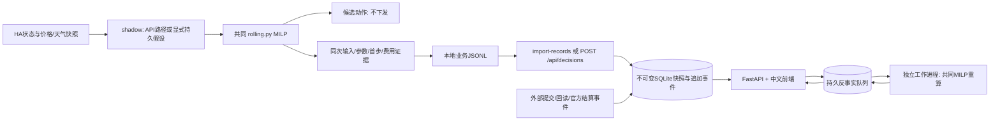

# 在共同仓库接入解释服务

本分支把 `explainability-app/` 放入策略仓库，并从**同一次 shadow 求解**导出完整证据。反事实直接调用本仓库 `src/energy_lab/rolling.py`，不另写一套策略方程。HA 提交、设备回读、官方结算继续由对应模块提供事件。

核查基线是 `main@8ac78e5dafadebb9909f3b3760760df74dc2e844`。该版本的 `rolling.py` 与历史日志恢复的原模型逐字节一致，SHA-256 为 `4197a84d871f635236b320f63e378bae6914e4fa9728d048a5ba08f8af9ba2d1`。`run_live.py` 当前仍走规则入口；本次接入的是只读 shadow，不代表在线控制入口已切换到 MILP。

## 接入的位置



| 位置 | 职责 |
| --- | --- |
| `src/energy_lab/shadow.py` | 可选证据回调；成功候选和未开启导出的调用保持原有行为 |
| `src/energy_lab/explainability_evidence.py` | 白名单构建业务记录，不含配置、认证响应或设备客户端 |
| `run_shadow_dry_run.py` | 显式开启后输出本地 JSONL，不自动发送给解释 API |
| `explainability-app/src/energy_explain/shared_provider.py` | 调用共同模型并核对源码哈希；不匹配时不借用历史副本 |
| `explainability-app/` | API、不可变留档、规则原因、反事实队列、有限追问、三页前端 |

`rolling.py` 只新增可选首步干预：`first_step` 固定首步充电、放电、购电、售电四项，或 `first_charge_kw` 固定首步电池充电。两者互斥；旧调用仍不固定首步。物理方程、原目标和默认参数保持不变。

新源码 SHA-256 为 `603de45ca089b13665abd91fe2f58aa12e576909dfcba2ffb481cff2aedd13a4`，共享模型版本为 `shared-milp-603de45c-cf1`。后续修改模型时，要同时审查导出契约、提供器版本与哈希；旧证据需保留匹配的模型才能重放，不允许静默使用新方程。

## 安装与启动

要求 Python 3.12、Node.js ≥22.12。以下 Bash 命令从**共同仓库根目录**执行：

```bash
python3.12 -m venv explainability-app/.venv
source explainability-app/.venv/bin/activate
python -m pip install -r explainability-app/requirements.lock -r explainability-app/requirements.shared.lock
python -m pip install --no-deps -e explainability-app
npm ci --prefix explainability-app/frontend
npm run build --prefix explainability-app/frontend
export PYTHONPATH="$PWD/explainability-app/src:$PWD/src"
```

Windows PowerShell 使用同样的目录和依赖文件：

```powershell
py -3.12 -m venv explainability-app/.venv
.\explainability-app\.venv\Scripts\Activate.ps1
python -m pip install -r explainability-app/requirements.lock -r explainability-app/requirements.shared.lock
python -m pip install --no-deps -e explainability-app
npm ci --prefix explainability-app/frontend
npm run build --prefix explainability-app/frontend
$env:PYTHONPATH = "$PWD\explainability-app\src;$PWD\src"
```

API 和工作进程必须使用相同 Python 环境、`PYTHONPATH`、数据库路径。分别在两个终端执行：

```bash
python -m energy_explain serve --db explainability-app/data/shared.sqlite --port 8080
python -m energy_explain.worker --db explainability-app/data/shared.sqlite --timeout 30
```

前端：`http://127.0.0.1:8080/`；OpenAPI：`http://127.0.0.1:8080/docs`。不导入数据时页面为空；服务不会自动填充人工记录。

## 先复现完整离线流程

以下只使用脚本生成的人工三站输入，设备时间与采集墙钟刻意分开。`--replay-at-capture` 仅在离线回放时按保存的采集时间检查新鲜度；不得用它宣称当前设备在线。

```bash
python explainability-app/scripts/create-shadow-fixture.py --output outputs/explainability-smoke-v2/input.json
python scripts/online/run_shadow_dry_run.py --snapshot outputs/explainability-smoke-v2/input.json --replay-at-capture --model-directory outputs/explainability-smoke-v2/no-models --output outputs/explainability-smoke-v2/shadow --explainability-run-id collaboration-smoke-v2 --explainability-input-kind synthetic
python -m energy_explain import-records --file outputs/explainability-smoke-v2/shadow/explainability-decisions.jsonl --db explainability-app/data/shared.sqlite
```

再次运行导入命令应返回 `records=3, created=0`。脚本和 runner 拒绝覆盖已有输出；重新实验使用新目录和新场次 ID。人工记录在三个页面均显示“模型接入验证 · 人工输入”。

`--model-directory .../no-models` 表示这个测试不加载已有预测 pickle；MILP 仍调用共同仓库源码。现有预测模型在本机反序列化缺少原训练模块，本轮没有把它们冒充可用的在线预测器。

真实快照准备好后，在原有私有运行配置下调用只读 runner，显式添加导出参数：

```bash
python scripts/online/run_shadow_dry_run.py --config local_online_config.json --model-directory outputs/shadow-team-run-001/no-models --output outputs/shadow-team-run-001 --explainability-run-id team-run-001 --explainability-input-kind mixed
python -m energy_explain import-records --file outputs/shadow-team-run-001/explainability-decisions.jsonl --db explainability-app/data/shared.sqlite
```

这两条真实读取命令需要自己的运行凭据和可访问环境。现场真实只读及连续采集已分别验收，见下方报告。示例暂不加载预测 pickle；API 路径与未来持久假设仍按实际来源保留。保持 `writes_performed=0`，检查 runner `status` 与 `explainability_export.status`；成功求解但证据失败时，原候选仍保留，但不能当作已导入的解释记录。

## 交接契约

- 输入按 `run_id + site_id + decision_id` 隔离。默认决策 ID 由场次、站点、设备 tick 生成；同一 tick 的输入若改变，必须提供新的明确决策 ID 或新场次，不能覆盖旧证据。
- 策略接口使用 W，解释接口使用 kW；96 步 × 0.25 小时，14 kWh、5 kW、充电效率 0.95、放电效率 1。导出保存当次实际参数，不从另一个快照补齐缺失值。
- 当前 shadow 的损耗代理为 **0.02 EUR/kWh**，期末估值为该次 96 点购电价均值。它们不同于四步演示的参数。保存购电、售电、损耗、期末库存四个分项并对账目标值。
- 当前 PV/load 是观测；未来序列分别标明预测或持久假设。人工回放显式标为 synthetic。未使用历史就保留 `history_mode=none, cache_tail=null`。
- `device_time` 定义模型时域；`observed_at` 是采集墙钟。充电动作是电池充电功率；放电动作是**并网点输出目标**，不把电池放电 W 直接写到 HA；hold 仍需外部监督与物理验证。
- 基准固定保存的首步四项功率并重放后续；替代只固定首步电池充电，再优化后续。缺失源码、哈希/版本不匹配或记录不完整时，明确不支持，不套用演示模型。
- JSONL 导入先检查全文件的记录格式，再逐条写入；每条幂等/冲突拒绝，**整批不保证事务原子性**。如某条业务身份冲突，前面成功导入的条目保留，修正后重试即可。
- 外部执行模块追加提交、回读事件；确认必须关联指令和有效观测时间。没有提交/回读时保持候选状态，没有官方结算时保持未结算。

## 分工与评审

建议由策略侧维护 `energy_lab` 的预测、MILP 参数及 HA 物理校准；解释侧维护 `explainability-app` 的证据存储、原因模板、工作进程与 UI。接口模式、模型版本、双时钟、控制语义和验收案例共同评审。

协作走功能分支与 Draft PR，评审后合并 main；不要把运行配置、令牌、原始会话 JSONL、数据库或实验输出提交。原独立仓库可作历史参考，共同策略的日常开发以这个仓库为准。

CI 分别运行策略 unittest、解释 pytest 与前端测试/构建，首次集成已在 GitHub 全部通过。解释测试须从 `explainability-app/` 运行，避免两个 `tests` 目录的 Python 名字碰撞。初始本地验收见 [共同仓库验收记录](../../explainability-app/docs/shared-integration-acceptance.md)。

随后已完成真实 HA 三站读取、现场输入的本地 shadow、证据导入及反事实验收，详见 [真实环境只读接入验收](../../explainability-app/docs/live-readonly-acceptance.md)。原共同仓库验收文档保留发布前的本地快照；最新远端 CI 状态以协作 PR 的 Checks 为准。

现已支持持续只读采集和可恢复 outbox；前端展示采集心跳、双时钟和记录新鲜度。外部执行回执与遥测通过完整指令身份、控制语义及物理约束校验后追加确认，直接导入外部 `confirmed` 断言会拒绝。启动命令、队列恢复、真实三站持续读取和接口示例见 [连续采集与执行证据接入](explainability-app/docs/continuous-readonly-integration.md)。

上一轮集成 PR 已合并 main，后续功能继续走独立分支评审。现已增加独立的 [有限 MILP 控制接入](explainability-app/docs/milp-control-integration.md)：同次候选留档后，通过 HA 逐服务提交、真实源时间遥测校验及追加执行证据串联；默认只读，显式开启才允许活动 mock 或自由运行场景的三站有限控制，逐站恢复自发自用。新入口不改变既有规则 runner，也不启动正式赛。长场持续控制、预测精度、云部署和官方结算仍需各自验收；模型费用与模拟器结果分别保留，不用影子目标冒充实际收益。
