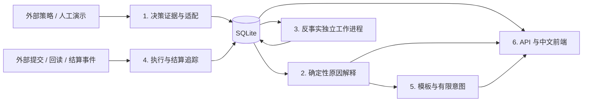

# 从决策到用户解释

策略引擎把同一时刻的输入、模型版本、候选动作和费用分项作为一条决策导入。解释服务保存不可变快照，追加记录解释、执行事件、反事实任务和结算；用户可以回查每个结论的依据。

## 数据一致性

`run_id + site_id + decision_id` 确定导入记录的业务身份。相同内容重复导入返回已有记录；同一身份但不同内容拒绝覆盖。快照哈希采用确定性 JSON 序列化后计算 SHA-256，解释引用保存的事实路径。

设备时间用于判断输入新鲜度和执行关联；墙上时钟观测与入库时间用于审计。加速模拟中的两种时钟不能直接比较。执行事件必须引用具体指令，回读设备时间早于提交设备时间的记录不能确认该指令，旧指令回读不能覆盖新指令的当前状态。

求解成功表示在给定假设下找到可行最优计划；预测状态描述数据与模型可用性；执行状态描述外部提交和回读；结算状态描述实际结算记录。前端把四种状态分别展示。

## 反事实计算

API 把任务持久化后立即返回任务身份。独立工作进程领取任务、计算并写回结果，默认一次只计算一个任务。任务具有租约，进程中断后可恢复；单任务默认 30 秒超时。正常原因卡直接从现有证据生成，不依赖工作进程。

任务可处于 `queued`、`running`、`ready`、`infeasible`、`timeout`、`unsupported` 或 `failed`。不可行表示模型证明给定干预无可行解；超时表示尚未得到结果；失败表示技术异常，不能替代模型结论。

人工模型限定在人工来源、对应版本及相同输入快照下使用。真实记录没有匹配模型时，查询决策和解释仍然可用，反事实返回不支持。注册真实模型后，原决策和替代决策必须使用相同输入、初始 SOC、模型版本、约束、时间步长和期末估值，只修改指定首步充电干预并重新优化后续。

## 计划可行性与光伏核算（E4）

计划检查通过 `POST /api/plans/feasibility` 创建持久任务，再由独立 worker 子进程求解；`GET /api/plans/{job_id}` 查询状态。任务固定引用一个不可变决策快照，以设备时间和已保存步长定位截止点，在指定步末施加 `energy_floor_kwh`。基准重放费用必须与保存的决策费用对账；找不到共享模型、源码哈希不符或优化器不支持电量下限时返回 `unsupported`，不能将其解释为不可行。不可行、超时与技术错误保持不同状态。候选调整方案逐个重新优化，仅代表同一快照假设下的模型费用。

光伏核算 CLI 从 replay trace 按站点日输出 JSONL；API 以 `(site_id, device_date, arm)` 幂等导入并提供日查询。PV 去向按“先负载、再电池、再电网”进行估算并检查功率/能量守恒；外送电量与负价外送损失保留 trace 来源。无潜在光伏出力就不能估算弃光，无额定充电功率就不统计充电功率瓶颈。报告不是设备实测或官方结算。

## 首版范围

使用模板和有限意图，不接入真实 LLM。服务只读取外部提供的控制证据，不直接控制 HA。计划可行性和基于 trace 的光伏核算为离线/只读能力；云端部署属于后续工作。
