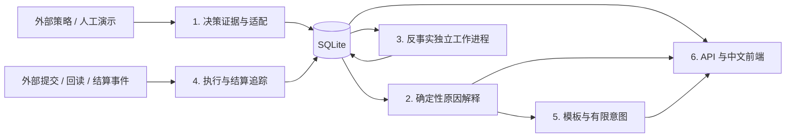

# 从决策到用户解释

策略引擎把同一时刻的输入、模型版本、候选动作和费用分项作为一条决策导入。解释服务保存不可变快照，追加记录解释、执行事件、反事实任务和结算；用户可以回查每个结论的依据。

## 数据一致性

`run_id + site_id + decision_id` 确定导入记录的业务身份。相同内容重复导入返回已有记录；同一身份但不同内容拒绝覆盖。快照哈希采用确定性 JSON 序列化后计算 SHA-256，解释引用保存的事实路径。

设备时间用于判断输入新鲜度和执行关联；墙上时钟观测与入库时间用于审计。加速模拟中的两种时钟不能直接比较。执行事件必须引用具体指令，回读设备时间早于提交设备时间的记录不能确认该指令，旧指令回读不能覆盖新指令的当前状态。

求解成功表示在给定假设下找到可行最优计划；预测状态描述数据与模型可用性；执行状态描述外部提交和回读；结算状态描述实际结算记录。前端把四种状态分别展示。

## 反事实计算

API 把任务持久化后立即返回任务身份。独立工作进程领取任务、计算并写回结果，默认一次只计算一个任务。任务具有租约，进程中断后可恢复；单任务默认 30 秒超时。正常原因卡直接从现有证据生成，不依赖工作进程。

任务可处于 `queued`、`running`、`ready`、`infeasible`、`timeout`、`unsupported` 或 `failed`。不可行表示模型证明给定干预无可行解；超时表示尚未得到结果；失败表示技术异常，不能替代模型结论。

人工模型限定在人工来源、对应版本及相同输入快照下使用。真实记录没有匹配模型时，查询决策和解释仍然可用，反事实返回不支持。注册真实模型后，原决策和替代决策必须使用相同输入、初始 SOC、模型版本、约束、时间步长和期末估值，只修改指定首步充电干预并重新优化后续。

## 首版范围

使用模板和有限意图，不接入真实 LLM。服务只读取外部提供的控制证据，不直接控制 HA。本轮新增用户计划和光伏/储能页面，计划评估与家庭偏好在浏览器保存；家庭联合调度、真实能源计量和云端部署仍属于后续工作。详见 [UIUX 重构说明](2026-10-14_家庭能源UIUX重构与功能规划.md)。
